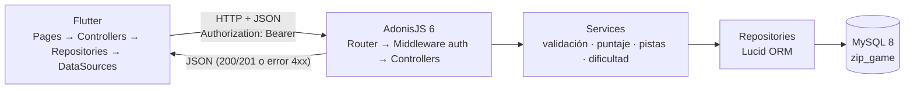

# Documentación de la API REST — ZIP Game

**Proyecto:** ZIP Game · Práctica I
**Asignatura:** Desarrollo para Dispositivos Inteligentes · Universidad Tecnológica de Durango (UTD)
**Backend:** AdonisJS 6 + TypeScript · **Base de datos:** MySQL 8 (Lucid ORM) · **Cliente:** Flutter

> **Origen de los ejemplos.** Las solicitudes y respuestas de este documento son reales. Se obtuvieron el 23 de noviembre de 2026 ejecutando la API contra la base de pruebas `zip_game_test`, que se usa para no alterar los datos de `zip_game`. Los identificadores, fechas y nombres de usuario corresponden a esa ejecución. Los tokens y las contraseñas se reemplazaron por marcadores (`<TOKEN>`, `<CONTRASEÑA>`).

---

## Tabla de contenido

1. [Introducción](#1-introducción)
2. [Arquitectura de comunicación](#2-arquitectura-de-comunicación)
3. [Convenciones generales](#3-convenciones-generales)
4. [Tabla general de endpoints](#4-tabla-general-de-endpoints)
5. [Documentación detallada de cada endpoint](#5-documentación-detallada-de-cada-endpoint)
6. [Códigos HTTP y manejo de errores](#6-códigos-http-y-manejo-de-errores)
7. [Seguridad](#7-seguridad)
8. [Pruebas y verificación](#8-pruebas-y-verificación)
9. [Relación con los requisitos del profesor](#9-relación-con-los-requisitos-del-profesor)
10. [Conclusión](#10-conclusión)

---

## 1. Introducción

La API REST de ZIP Game es el servidor que concentra la lógica y los datos del juego.
La aplicación Flutter no decide si una partida es válida ni cuántos puntos vale: envía el camino que dibujó el jugador y la API:

- valida cada regla del juego;
- calcula el puntaje con la hora del servidor;
- guarda el resultado en MySQL;
- devuelve la respuesta al cliente.

Toda la comunicación usa **HTTP** con cuerpos en **JSON**. Así se cumple la regla de oro de la práctica: *"el backend vuelve a validar la solución completa antes de dar puntos"*.

## 2. Arquitectura de comunicación

| Componente | Tecnología | Función |
|---|---|---|
| Cliente | Flutter (web y Android) | Interfaz y estado local; hace las peticiones mediante `ApiClient` (`lib/core/network/api_client.dart`) |
| Servidor REST | AdonisJS 6 | Rutas, validación (VineJS), autenticación, servicios y repositorios |
| Acceso a datos | Lucid ORM | Modelos `User`, `Level`, `GameSession`, `GameMove` y `Score` |
| Persistencia | MySQL 8 | Tablas `users`, `auth_access_tokens`, `levels`, `game_sessions`, `game_moves` y `scores` |
| Autenticación | Bearer Token | Tokens opacos con prefijo `zip_`, vigentes 7 días; en la base solo se guarda su hash |
| Formato | JSON | Solicitudes y respuestas con `snake_case` |

**URL base en desarrollo:** `http://localhost:3333/api`.

En Flutter se puede cambiar con `--dart-define=API_URL=...`. Por ejemplo, el emulador de Android usa `http://10.0.2.2:3333/api`.



**Flujo interno de una petición en el backend:**

1. **Router:** `start/routes.ts`.
2. **Middleware `auth`:** solo en las rutas protegidas.
3. **Controlador:** valida con VineJS.
4. **Servicio:** aplica la lógica del juego.
5. **Repositorio:** ejecuta las consultas con Lucid.
6. **Presentador:** `app/utils/presenters.ts` define exactamente qué campos se envían al cliente.

## 3. Convenciones generales

### Métodos

La API usa solo dos métodos:

- **`GET`** para consultar: niveles, partida, historial, perfil y ranking.
- **`POST`** para crear o ejecutar acciones: registro, login, logout, generar nivel, iniciar partida, pedir pista y terminar partida.

### Encabezados

| Encabezado | Cuándo | Valor |
|---|---|---|
| `Content-Type` | Peticiones `POST` con cuerpo | `application/json` |
| `Accept` | Todas (Flutter siempre lo envía) | `application/json` |
| `Authorization` | Rutas protegidas | `Bearer <TOKEN>` |

El token se obtiene en `/auth/register` o `/auth/login`, dentro de `token.value`. Flutter lo guarda con `shared_preferences` y lo agrega automáticamente a cada petición.

### Rutas públicas y protegidas

- **Públicas:** `POST /auth/register`, `POST /auth/login` y `GET /leaderboard`.
- **Protegidas:** todas las demás. Sin un token válido responden `401`.

### Parámetros

- **De ruta:** `:id` en `/levels/:id` y `/games/:id/...`. Debe ser numérico; si no lo es, la ruta no coincide y responde `404` (ver la observación de la sección 6).
- **Query:** `difficulty`, `page`, `per_page` y `limit`. Se validan con `listQueryValidator`.

### Numeración del tablero

El tablero tiene 6 × 6 celdas, numeradas de `0` a `35` con `índice = fila × 6 + columna`. Los checkpoints se envían como una lista en la que `checkpoints[i]` es la celda del número `i + 1`.

### Formatos de error

El backend responde con tres estructuras, según el origen del error:

| Origen | Estructura | Ejemplo de uso |
|---|---|---|
| Reglas del juego (`GameException`, respuesta 422 de `finish`) | `{ "message", "code", "details"? }` | 404, 409 y 422 de partidas |
| Validación VineJS y autenticación | `{ "errors": [ { "message", "rule"?, "field"?, "meta"? } ] }` | 400, 401 y 422 de formulario |
| Registro inexistente (Lucid `findOrFail`) | `{ "message": "Resource not found", "code": "E_NOT_FOUND" }` | 404 de nivel |

## 4. Tabla general de endpoints

Rutas verificadas contra `start/routes.ts` y con `node ace list:routes`.

| # | Método | Ruta (`/api` +) | Descripción | Auth | Éxito | ¿Lo usa Flutter? |
|---|---|---|---|:-:|:-:|:-:|
| 1 | `POST` | `/auth/register` | Registrar jugador | No | `201` | Sí |
| 2 | `POST` | `/auth/login` | Iniciar sesión | No | `200` | Sí |
| 3 | `POST` | `/auth/logout` | Cerrar sesión (revoca el token) | Sí | `200` | Sí |
| 4 | `GET` | `/users/me` | Perfil, estadísticas y niveles completados | Sí | `200` | Sí |
| 5 | `GET` | `/levels` | Lista de niveles con progreso | Sí | `200` | Sí |
| 6 | `GET` | `/levels/:id` | Un nivel, sin solución | Sí | `200` | Disponible en la capa *data*, sin pantalla que lo invoque |
| 7 | `POST` | `/levels/generate` | Generar y guardar un nivel | Sí | `201` | Sí |
| 8 | `POST` | `/games` | Iniciar partida | Sí | `201` | Sí |
| 9 | `GET` | `/games/history` | Historial del jugador | Sí | `200` | Sí |
| 10 | `GET` | `/games/:id` | Estado de una partida propia | Sí | `200` | No (uso administrativo o de pruebas) |
| 11 | `POST` | `/games/:id/hint` | Pedir una pista | Sí | `200` | Sí |
| 12 | `POST` | `/games/:id/finish` | Validar y terminar la partida | Sí | `200` | Sí |
| 13 | `GET` | `/leaderboard` | Ranking global | No | `200` | Sí |

Además existe `GET /` (fuera de `/api`), que responde `{"name":"ZIP Game API","version":"1.0.0","status":"ok"}` y sirve para comprobar que el servidor está encendido.

---

## 5. Documentación detallada de cada endpoint

### 5.1 Registrar jugador

| Propiedad | Valor |
|---|---|
| Propósito | Crear una cuenta y devolver un token para iniciar sesión de inmediato |
| Método y ruta | `POST /api/auth/register` |
| Autenticación | No requerida |
| Encabezados | `Content-Type: application/json` |
| Parámetros de ruta / query | Ninguno |
| Procesa | `AuthController.register` → `registerValidator` → `UserRepository.create` → `User.accessTokens.create` |

**Cuerpo de la solicitud**

| Campo | Tipo | Obligatorio | Descripción |
|---|---|:-:|---|
| `username` | string | Sí | 3 a 30 caracteres; solo letras, números y `_`; único |
| `email` | string | Sí | Correo válido (se normaliza), máximo 254 caracteres; único |
| `password` | string | Sí | 8 a 64 caracteres |

```json
{ "username": "ana_68895", "email": "ana_68895@zipgame.test", "password": "<CONTRASEÑA>" }
```

**Respuesta `201 Created`**

```json
{
  "user": {
    "id": 13,
    "username": "ana_68895",
    "email": "ana_68895@zipgame.test",
    "recommended_difficulty": "easy",
    "created_at": "2026-11-24T02:22:49.048+00:00"
  },
  "token": { "type": "bearer", "value": "<TOKEN>", "expires_at": "2026-12-01T02:22:49.053Z" }
}
```

La contraseña nunca aparece en la respuesta. Todo usuario nuevo empieza con `recommended_difficulty: "easy"`.

**Errores**

| Código | Causa | Respuesta real |
|---|---|---|
| `422` | Datos inválidos, o `username` o `email` ya registrados | `{"errors":[{"message":"The username field must have at least 3 characters","rule":"minLength","field":"username","meta":{"min":3}}, {"message":"The email field must be a valid email address","rule":"email","field":"email"}, {"message":"The password field must have at least 8 characters","rule":"minLength","field":"password","meta":{"min":8}}]}` |

**Verificación:**
- **Flutter:** pantalla *Regístrate*; en Network aparece la petición `register`.
- **Pruebas:** `functional/api.spec.ts` → *registers a player and returns a token* y *returns 422 for invalid registration data*.

---

### 5.2 Iniciar sesión

| Propiedad | Valor |
|---|---|
| Propósito | Verificar las credenciales y emitir un token Bearer nuevo |
| Método y ruta | `POST /api/auth/login` |
| Autenticación | No requerida |
| Encabezados | `Content-Type: application/json` |
| Parámetros de ruta / query | Ninguno |
| Procesa | `AuthController.login` → `loginValidator` → `User.verifyCredentials` (compara el hash scrypt) |

**Cuerpo de la solicitud**

| Campo | Tipo | Obligatorio | Descripción |
|---|---|:-:|---|
| `email` | string | Sí | Correo registrado |
| `password` | string | Sí | Contraseña (mínimo 1 carácter en este endpoint) |

```json
{ "email": "ana_68895@zipgame.test", "password": "<CONTRASEÑA>" }
```

**Respuesta `200 OK`:** tiene la misma estructura que el registro (`user` y `token`).

**Errores**

| Código | Causa | Respuesta real |
|---|---|---|
| `400` | Correo o contraseña incorrectos | `{"errors":[{"message":"Invalid user credentials"}]}` |
| `422` | Faltan campos o el correo no tiene formato válido | `{"errors":[{"message":"The email field must be a valid email address","rule":"email","field":"email"},{"message":"The password field must be defined","rule":"required","field":"password"}]}` |

El mensaje del `400` es el mismo si el correo no existe o si la contraseña es incorrecta. Así no se revela qué cuentas existen.

**Verificación:**
- **Flutter:** pantalla de inicio de sesión → petición `login`.
- **Pruebas:** `functional/api.spec.ts` → *logs in with valid credentials and rejects bad ones*.

---

### 5.3 Cerrar sesión

| Propiedad | Valor |
|---|---|
| Propósito | Revocar el token con el que se hace la petición |
| Método y ruta | `POST /api/auth/logout` |
| Autenticación | **Requerida** |
| Encabezados | `Authorization: Bearer <TOKEN>` |
| Cuerpo | **No recibe cuerpo JSON** (Flutter envía `{}`, que se ignora) |
| Procesa | `AuthController.logout` → `User.accessTokens.delete` |

**Respuesta `200 OK`**

```json
{ "message": "Logged out" }
```

**Errores:** `401` si el token falta o ya no es válido.

Se comprobó que, después del logout, el mismo token recibe `401` en `GET /api/levels`.

**Verificación:** en Flutter, el botón de salir de la pantalla de inicio genera la petición `logout`.

---

### 5.4 Perfil del jugador autenticado

| Propiedad | Valor |
|---|---|
| Propósito | Devolver los datos del jugador, sus estadísticas y los niveles que completó |
| Método y ruta | `GET /api/users/me` |
| Autenticación | **Requerida** |
| Encabezados | `Authorization: Bearer <TOKEN>` |
| Parámetros / cuerpo | Ninguno; **no recibe cuerpo JSON** |
| Procesa | `UsersController.me` → `UserRepository.stats` + `LevelRepository.listWithProgress` |

**Respuesta `200 OK`**

```json
{
  "user": {
    "id": 13,
    "username": "ana_68895",
    "email": "ana_68895@zipgame.test",
    "recommended_difficulty": "easy",
    "created_at": "2026-11-24T02:22:49.000+00:00"
  },
  "stats": {
    "games_played": 1,
    "games_completed": 1,
    "levels_completed": 1,
    "total_points": 1057,
    "best_score": 1057
  },
  "completed_levels": [
    { "id": 8, "name": "Tutorial", "difficulty": "easy", "best_score": 1057 }
  ]
}
```

**Errores:** `401` sin token o con un token inválido.

**Verificación:** en Flutter, *Mi perfil* genera la petición `me`.

---

### 5.5 Listar niveles

| Propiedad | Valor |
|---|---|
| Propósito | Listar los niveles con su configuración pública, si el jugador ya los completó y su mejor puntaje |
| Método y ruta | `GET /api/levels` |
| Autenticación | **Requerida** |
| Encabezados | `Authorization: Bearer <TOKEN>` |
| Cuerpo | **No recibe cuerpo JSON** |
| Procesa | `LevelsController.index` → `listQueryValidator` → `LevelRepository.listWithProgress` → `presentLevel` |

**Parámetros query**

| Campo | Tipo | Obligatorio | Descripción |
|---|---|:-:|---|
| `difficulty` | `easy` \| `medium` \| `hard` | No | Filtra por dificultad |

Los niveles se ordenan por dificultad (fácil, media, difícil) y luego por `id`.

**Solicitud:** `GET /api/levels?difficulty=hard`

**Respuesta `200 OK`** (se muestra solo el primer elemento de `data`):

```json
{
  "recommended_difficulty": "easy",
  "data": [
    {
      "id": 15,
      "name": "Vortex",
      "difficulty": "hard",
      "size": 6,
      "checkpoints": [9, 16, 30, 25, 20],
      "checkpoint_count": 5,
      "difficulty_score": 78,
      "is_generated": false,
      "completed": false,
      "best_score": null
    }
  ]
}
```

- `best_score` es `null` mientras el jugador no complete el nivel.
- El campo `solution` **no se envía nunca**: el presentador no lo incluye y el modelo lo marca con `serializeAs: null`.

**Errores**

| Código | Causa | Respuesta real |
|---|---|---|
| `401` | Sin token o token inválido | `{"errors":[{"message":"Unauthorized access"}]}` |
| `422` | `difficulty` fuera del catálogo | `{"errors":[{"message":"The selected difficulty is invalid","rule":"enum","field":"difficulty","meta":{"choices":["easy","medium","hard"]}}]}` |

**Verificación:**
- **Flutter:** pantalla *Niveles* → petición `levels`; con un filtro aparece `levels?difficulty=...`.
- **Pruebas:** *lists levels without exposing the solution*.

---

### 5.6 Obtener un nivel

| Propiedad | Valor |
|---|---|
| Propósito | Consultar la configuración de un tablero sin su solución |
| Método y ruta | `GET /api/levels/:id` |
| Autenticación | **Requerida** |
| Parámetros de ruta | `id` (entero) |
| Cuerpo | **No recibe cuerpo JSON** |
| Procesa | `LevelsController.show` → `LevelRepository.findOrFail` → `presentLevel` |

**Respuesta `200 OK`**

```json
{
  "data": {
    "id": 8,
    "name": "Tutorial",
    "difficulty": "easy",
    "size": 6,
    "checkpoints": [0, 5, 7, 15, 21, 25, 35, 30],
    "checkpoint_count": 8,
    "difficulty_score": 45,
    "is_generated": false
  }
}
```

**Errores**

| Código | Causa | Respuesta real |
|---|---|---|
| `401` | Sin token o token inválido | `{"errors":[{"message":"Unauthorized access"}]}` |
| `404` | El nivel no existe | `{"message":"Resource not found","code":"E_NOT_FOUND"}` |

**Verificación:**
- **curl:** `curl -H "Authorization: Bearer <TOKEN>" http://localhost:3333/api/levels/8`.
- **Pruebas:** *returns 404 for a missing level*.
- La app Flutter no tiene una pantalla que llame este endpoint.

---

### 5.7 Generar un nivel

| Propiedad | Valor |
|---|---|
| Propósito | Crear un tablero 6 × 6 con solución garantizada, medir su dificultad y guardarlo en MySQL |
| Método y ruta | `POST /api/levels/generate` |
| Autenticación | **Requerida** |
| Encabezados | `Content-Type: application/json`, `Authorization: Bearer <TOKEN>` |
| Procesa | `LevelsController.generate` → `generateLevelValidator` → `LevelGeneratorService.generate` (camino hamiltoniano + *backbite*, verificado con `PathSolverService` y `GameValidatorService`) → `LevelRepository.create` |

**Cuerpo de la solicitud**

| Campo | Tipo | Obligatorio | Descripción |
|---|---|:-:|---|
| `difficulty` | `easy` \| `medium` \| `hard` | Sí | Dificultad que se busca |
| `name` | string | No | 3 a 80 caracteres; si se omite, se genera un nombre (por ejemplo, `Sunrise #529`) |

```json
{ "difficulty": "easy" }
```

**Respuesta `201 Created`**

```json
{
  "data": {
    "id": 18,
    "name": "Sunrise #529",
    "difficulty": "easy",
    "size": 6,
    "checkpoints": [16, 9, 5, 1, 7, 24, 25, 32, 35, 21, 17],
    "checkpoint_count": 11,
    "difficulty_score": 43,
    "is_generated": true
  },
  "metrics": {
    "checkpointCount": 11,
    "averageGap": 3.5,
    "solutionCount": 4,
    "searchEffort": 178,
    "turns": 19,
    "score": 43
  }
}
```

**Observación:** el objeto `metrics` usa `camelCase`, a diferencia del resto de la API. Así lo devuelve el código (`generated.metrics`), y Flutter solo lee `data`.

**Errores**

| Código | Causa | Respuesta real |
|---|---|---|
| `401` | Sin token o token inválido | `{"errors":[{"message":"Unauthorized access"}]}` |
| `422` | `difficulty` inválida | `{"errors":[{"message":"The selected difficulty is invalid","rule":"enum","field":"difficulty","meta":{"choices":["easy","medium","hard"]}}]}` |

**Verificación:**
- **Flutter:** botón *Generar* en *Niveles* → petición `generate`.
- **Pruebas:** *generates and stores a new level*.

---

### 5.8 Iniciar partida

| Propiedad | Valor |
|---|---|
| Propósito | Crear una sesión de juego ligada al usuario y al nivel, con la hora de inicio del **servidor** |
| Método y ruta | `POST /api/games` |
| Autenticación | **Requerida** |
| Encabezados | `Content-Type: application/json`, `Authorization: Bearer <TOKEN>` |
| Procesa | `GamesController.store` → `startGameValidator` → `GameService.start` → `LevelRepository` + `GameSessionRepository.start` |

**Cuerpo de la solicitud**

| Campo | Tipo | Obligatorio | Descripción |
|---|---|:-:|---|
| `level_id` | entero positivo | No | Nivel que se va a jugar. Si se omite, el sistema adaptativo elige el primer nivel pendiente de la dificultad recomendada; si no hay, busca uno fácil |

```json
{ "level_id": 8 }
```

**Respuesta `201 Created`**

```json
{
  "session": {
    "id": 6,
    "level_id": 8,
    "status": "in_progress",
    "difficulty": "easy",
    "started_at": "2026-11-24T02:22:49.285+00:00",
    "finished_at": null,
    "mistakes": 0,
    "hints_used": 0,
    "failed_attempts": 0
  },
  "level": {
    "id": 8,
    "name": "Tutorial",
    "difficulty": "easy",
    "size": 6,
    "checkpoints": [0, 5, 7, 15, 21, 25, 35, 30],
    "checkpoint_count": 8,
    "difficulty_score": 45,
    "is_generated": false
  }
}
```

**Observación:** en esta respuesta no aparece `duration_seconds`. El presentador lo incluye, pero su valor es `undefined` en una sesión recién creada, y JSON omite los valores `undefined`. En `GET /games/:id` sí aparece, con valor `null`.

**Errores**

| Código | Causa | Respuesta |
|---|---|---|
| `401` | Sin token o token inválido | `{"errors":[{"message":"Unauthorized access"}]}` |
| `404` | `level_id` no existe | `{"message":"Resource not found","code":"E_NOT_FOUND"}` *(verificado)* |
| `404` | Sin `level_id` y sin niveles pendientes | `{"message":"There are no pending levels. Generate a new one.","code":"E_NO_LEVELS"}` *(según `GameService.start`; no se provocó en las pruebas)* |
| `422` | `level_id` no es un entero positivo | Formato VineJS `{"errors":[...]}` |

**Verificación:**
- **Flutter:** al abrir un nivel aparece la petición `games` con estado `201`.
- **Pruebas:** *full flow: start, hint, finish with a valid solution*.

---

### 5.9 Historial de partidas

| Propiedad | Valor |
|---|---|
| Propósito | Listar, paginadas, **solo las partidas del usuario autenticado** |
| Método y ruta | `GET /api/games/history` |
| Autenticación | **Requerida** |
| Cuerpo | **No recibe cuerpo JSON** |
| Procesa | `GamesController.history` → `listQueryValidator` → `GameSessionRepository.history` (filtra por `user_id`) |

**Parámetros query**

| Campo | Tipo | Obligatorio | Descripción |
|---|---|:-:|---|
| `page` | entero positivo | No | Página (predeterminado: 1) |
| `per_page` | entero 1–50 | No | Elementos por página (predeterminado: 10; Flutter usa 20) |

**Solicitud:** `GET /api/games/history?page=1&per_page=20`

**Respuesta `200 OK`**

```json
{
  "meta": { "total": 1, "per_page": 20, "current_page": 1, "last_page": 1 },
  "data": [
    {
      "id": 6,
      "level_id": 8,
      "status": "completed",
      "difficulty": "easy",
      "started_at": "2026-11-24T02:22:49.000+00:00",
      "finished_at": "2026-11-24T02:22:49.000+00:00",
      "duration_seconds": 1,
      "mistakes": 0,
      "hints_used": 2,
      "failed_attempts": 1,
      "level": { "id": 8, "name": "Tutorial" },
      "points": 1057
    }
  ]
}
```

`points` es `null` en las partidas que no se terminaron. Las partidas aparecen de la más reciente a la más antigua.

**Errores**

| Código | Causa | Respuesta real |
|---|---|---|
| `401` | Sin token o token inválido | `{"errors":[{"message":"Unauthorized access"}]}` |
| `422` | `per_page` fuera de rango | `{"errors":[{"message":"The per_page field must be between 1 and 50","rule":"range","field":"per_page","meta":{"min":1,"max":50}}]}` |

**Verificación:**
- **Flutter:** *Mi perfil* → petición `history?page=1&per_page=20`.
- **Pruebas:** *history and leaderboard reflect persisted results*.

---

### 5.10 Consultar una partida

| Propiedad | Valor |
|---|---|
| Propósito | Ver el estado de una partida **propia** |
| Método y ruta | `GET /api/games/:id` |
| Autenticación | **Requerida** |
| Parámetros de ruta | `id` (entero) |
| Cuerpo | **No recibe cuerpo JSON** |
| Procesa | `GamesController.show` → `GameSessionRepository.findOwned` (filtra por `id` **y** `user_id`) |

**Respuesta `200 OK`**

```json
{
  "session": {
    "id": 6,
    "level_id": 8,
    "status": "in_progress",
    "difficulty": "easy",
    "started_at": "2026-11-24T02:22:49.000+00:00",
    "finished_at": null,
    "duration_seconds": null,
    "mistakes": 0,
    "hints_used": 0,
    "failed_attempts": 0
  }
}
```

**Errores**

| Código | Causa | Respuesta real |
|---|---|---|
| `401` | Sin token o token inválido | `{"errors":[{"message":"Unauthorized access"}]}` |
| `404` | La partida no existe **o pertenece a otro jugador** | `{"message":"Game session not found","code":"E_SESSION_NOT_FOUND"}` |

Se comprobó que un segundo usuario recibe este `404` al consultar la partida del primero.

**Verificación:** con curl (la app Flutter no llama este endpoint): `curl -H "Authorization: Bearer <TOKEN>" http://localhost:3333/api/games/6`.

---

### 5.11 Pedir una pista

| Propiedad | Valor |
|---|---|
| Propósito | Validar el camino actual y sugerir la siguiente celda, o indicar cuántos pasos retroceder, sin revelar la solución completa |
| Método y ruta | `POST /api/games/:id/hint` |
| Autenticación | **Requerida** |
| Parámetros de ruta | `id` de la partida |
| Procesa | `GamesController.hint` → `hintValidator` → `GameService.hint` → `HintService.getHint` (usa `GameValidatorService` y `PathSolverService`) → incrementa `hints_used` |

**Cuerpo de la solicitud**

| Campo | Tipo | Obligatorio | Descripción |
|---|---|:-:|---|
| `path` | entero[] | Sí | Camino actual: celdas de 0 a 35, máximo 36 elementos; puede estar vacío |

```json
{ "path": [0] }
```

**Respuesta `200 OK`, tipo `next`** (la siguiente celda sugerida):

```json
{ "hint": { "type": "next", "next_cell": 1 }, "hints_used": 2 }
```

**Respuesta `200 OK`, tipo `backtrack`** (estructura definida en el controlador; se devuelve cuando el camino es válido pero ya no tiene solución):

```json
{ "hint": { "type": "backtrack", "undo_steps": 3, "next_cell": 14 }, "hints_used": 1 }
```

*El ejemplo `backtrack` es ilustrativo: los valores dependen del camino.*

**Errores**

| Código | Causa | Respuesta real |
|---|---|---|
| `401` | Sin token o token inválido | `{"errors":[{"message":"Unauthorized access"}]}` |
| `404` | La partida no existe o es de otro jugador | `{"message":"Game session not found","code":"E_SESSION_NOT_FOUND"}` |
| `409` | La partida ya terminó | `{"message":"This game session is already finished","code":"E_ALREADY_FINISHED"}` |
| `422` | El camino rompe una regla (`E_INVALID_START`, `E_NOT_ADJACENT`, `E_REPEATED_CELL`, `E_CHECKPOINT_ORDER`, `E_PREMATURE_END`, `E_COMPLETE`, …) | `{"message":"The path must start on number 1","code":"E_INVALID_START","details":{"index":0}}` |
| `422` | Celda fuera de 0–35 (VineJS) | `{"errors":[{"message":"The 0 field must not be greater than 35","rule":"max","field":"path.0","meta":{"max":35},"index":0}]}` |

Una pista que termina en error no incrementa `hints_used`.

**Verificación:**
- **Flutter:** botón *Pista* → petición `hint`.
- **Pruebas:** `unit/scoring_hint_adaptive.spec.ts` (grupo *HintService*) y el flujo completo de `functional/api.spec.ts`.

---

### 5.12 Terminar partida

| Propiedad | Valor |
|---|---|
| Propósito | Validar en el servidor la solución completa, calcular el puntaje, guardar los movimientos y el resultado, y actualizar la dificultad recomendada |
| Método y ruta | `POST /api/games/:id/finish` |
| Autenticación | **Requerida** |
| Parámetros de ruta | `id` de la partida |
| Procesa | `GamesController.finish` → `finishGameValidator` → `GameService.finish`, que usa una **transacción** con `SELECT … FOR UPDATE` |

`GameService.finish` coordina los siguientes servicios y repositorios:

- **Servicios:** `GameValidatorService`, `ScoringService` y `AdaptiveDifficultyService`.
- **Repositorios:** `GameSessionRepository.saveMoves`, `ScoreRepository.create` y `UserRepository.updateRecommendedDifficulty`.

**Cuerpo de la solicitud**

| Campo | Tipo | Obligatorio | Descripción |
|---|---|:-:|---|
| `path` | entero[] | Sí | Camino completo: de 1 a 36 celdas, cada una de 0 a 35 |
| `moves` | objeto[] | No | Registro de interacciones (máximo 5000) |
| `moves[].type` | `add` \| `undo` \| `invalid` \| `restart` | Sí | Tipo de interacción |
| `moves[].cell` | entero 0–35 o `null` | No | Celda involucrada |
| `moves[].elapsed_ms` | entero ≥ 0 | No | Milisegundos desde el inicio |

```json
{
  "path": [0, 1, 2, 3, 4, 5, 11, 10, 9, 8, 7, 6, 12, 13, "… 36 celdas en total …"],
  "moves": [
    { "type": "add", "cell": 0, "elapsed_ms": 900 },
    { "type": "invalid", "cell": 14, "elapsed_ms": 1500 },
    { "type": "add", "cell": 1, "elapsed_ms": 1800 }
  ]
}
```

*El cuerpo está abreviado: un `path` real lleva exactamente 36 enteros.*

El cliente **no envía** puntos, duración ni número de errores:

- los errores se cuentan en el servidor a partir de los movimientos de tipo `invalid`;
- la duración se calcula con la hora del servidor.

**Respuesta `200 OK`**

```json
{
  "message": "Puzzle solved!",
  "session": {
    "id": 6,
    "level_id": 8,
    "status": "completed",
    "difficulty": "easy",
    "started_at": "2026-11-24T02:22:49.000+00:00",
    "finished_at": "2026-11-24T02:22:49.373+00:00",
    "duration_seconds": 1,
    "mistakes": 0,
    "hints_used": 2,
    "failed_attempts": 1
  },
  "score": {
    "points": 1057,
    "duration_seconds": 1,
    "mistakes": 0,
    "hints_used": 2,
    "breakdown": {
      "base": 1000,
      "time_bonus": 357,
      "time_penalty": 0,
      "mistake_penalty": 0,
      "hint_penalty": 300
    }
  },
  "performance": "normal",
  "difficulty": {
    "previous": "easy",
    "recommended": "easy",
    "change": "keep",
    "reason": "Performance is stable"
  }
}
```

Cálculo del ejemplo: 1000 + 357 − 0 − 0 − 300 = **1057**.

Valores posibles:

- `performance`: `excellent`, `normal` o `poor`.
- `difficulty.change`: `increase`, `decrease` o `keep`.

**Errores**

| Código | Causa | Respuesta real |
|---|---|---|
| `401` | Sin token o token inválido | `{"errors":[{"message":"Unauthorized access"}]}` |
| `404` | La partida no existe o es de otro jugador | `{"message":"Game session not found","code":"E_SESSION_NOT_FOUND"}` |
| `409` | La partida ya fue terminada | `{"message":"This game session is already finished","code":"E_ALREADY_FINISHED"}` |
| `422` | La solución rompe una regla | Ver el ejemplo siguiente |
| `422` | Cuerpo inválido (VineJS) | `{"errors":[{"message":"The path field must have at least 1 items","rule":"array.minLength","field":"path","meta":{"min":1}}]}` |

Ejemplo real de solución inválida (camino incompleto):

```json
{
  "message": "The path covers 1 of 36 cells",
  "code": "E_INCOMPLETE",
  "details": { "index": 1 },
  "session": {
    "id": 6,
    "level_id": 8,
    "status": "in_progress",
    "difficulty": "easy",
    "started_at": "2026-11-24T02:22:49.000+00:00",
    "finished_at": null,
    "duration_seconds": null,
    "mistakes": 0,
    "hints_used": 2,
    "failed_attempts": 1
  }
}
```

Los códigos de regla posibles son:

| Código | Regla que se rompe |
|---|---|
| `E_INVALID_START` | El camino no empieza en el número 1 |
| `E_NOT_ADJACENT` | Movimiento diagonal o salto |
| `E_REPEATED_CELL` | Celda repetida |
| `E_CHECKPOINT_ORDER` | Números fuera de orden |
| `E_PREMATURE_END` | Llega al último número antes de llenar el tablero |
| `E_INCOMPLETE` | No cubre las 36 celdas |
| `E_INVALID_END` | No termina en el número más alto |
| `E_OUT_OF_BOUNDS` | Celda fuera del tablero |

`E_EMPTY_PATH` existe en el validador del juego, pero no llega a este endpoint: VineJS rechaza antes un `path` vacío con el 422 de formato.

Cuando la solución rompe una regla del juego, la partida sigue `in_progress` y se incrementa `failed_attempts`. Un error de formato de VineJS no modifica la sesión.

**Verificación:**
- **Flutter:** al completar el tablero se envía la petición `finish`, y el resumen muestra `score.points` y `breakdown`.
- **Pruebas:**
  - *full flow: start, hint, finish with a valid solution*;
  - *rejects an invalid solution with 422*;
  - *prevents finishing the same game twice*;
  - *a player cannot finish another player game*.

---

### 5.13 Ranking global

| Propiedad | Valor |
|---|---|
| Propósito | Clasificar a los jugadores con reglas documentadas |
| Método y ruta | `GET /api/leaderboard` |
| Autenticación | No requerida (Flutter envía el token de todos modos; no afecta el resultado) |
| Cuerpo | **No recibe cuerpo JSON** |
| Procesa | `LeaderboardController.index` → `listQueryValidator` → `LeaderboardService.top` → `ScoreRepository.leaderboard` |

**Parámetros query**

| Campo | Tipo | Obligatorio | Descripción |
|---|---|:-:|---|
| `limit` | entero 1–100 | No | Número de posiciones (predeterminado: 20) |

**Regla de orden** (implementada en SQL dentro de `ScoreRepository.leaderboard`):

1. Por cada par usuario-nivel se toma solo el **mejor** puntaje, para que repetir un nivel no acumule puntos.
2. `total_score` es la suma de esos mejores puntajes.
3. Desempates, en este orden: más `levels_completed`, menor `total_time_seconds` y menor `user_id`.

**Respuesta `200 OK`**

```json
{
  "rules": "Sum of best score per level; ties: more levels, less total time",
  "data": [
    {
      "rank": 1,
      "user_id": 13,
      "username": "ana_68895",
      "total_score": 1057,
      "levels_completed": 1,
      "total_time_seconds": 1,
      "best_single_score": 1057
    }
  ]
}
```

**Errores**

| Código | Causa | Respuesta real |
|---|---|---|
| `422` | `limit` fuera de 1–100 | `{"errors":[{"message":"The limit field must be between 1 and 100","rule":"range","field":"limit","meta":{"min":1,"max":100}}]}` |

**Verificación:**
- **Flutter:** pantalla *Ranking* → petición `leaderboard?limit=20`.
- **Pruebas:** *history and leaderboard reflect persisted results*.

---

## 6. Códigos HTTP y manejo de errores

Cada código aparece solo en los endpoints indicados; no todos los endpoints usan todos los códigos.

| Código | Significado | Endpoints donde se presenta | Situación que lo provoca | Estructura JSON |
|---|---|---|---|---|
| **200 OK** | Operación correcta | Login, logout, `users/me`, `levels`, `levels/:id`, `games/history`, `games/:id`, `hint`, `finish` y `leaderboard` | Petición válida | Propia de cada endpoint (sección 5) |
| **201 Created** | Recurso creado | `auth/register`, `levels/generate` y `games` | Se creó un usuario, un nivel o una sesión | Propia de cada endpoint |
| **400 Bad Request** | Credenciales inválidas | **Solo** `auth/login` | Correo o contraseña incorrectos | `{"errors":[{"message":"Invalid user credentials"}]}` |
| **401 Unauthorized** | Sin autenticación | Todas las rutas protegidas (no `register`, `login` ni `leaderboard`) | Falta el header, el token es inválido o se revocó con logout | `{"errors":[{"message":"Unauthorized access"}]}` |
| **404 Not Found** | No existe o no te pertenece | `levels/:id`, `games` (con `level_id`), `games/:id`, `hint` y `finish` | Nivel inexistente, partida inexistente o **ajena**, o sin niveles pendientes | `{"message","code"}` con `E_NOT_FOUND`, `E_SESSION_NOT_FOUND` o `E_NO_LEVELS` |
| **409 Conflict** | Partida ya terminada | **Solo** `hint` y `finish` | La sesión ya no está `in_progress` | `{"message":"This game session is already finished","code":"E_ALREADY_FINISHED"}` |
| **422 Unprocessable Entity** | Datos o solución inválidos | Todos los endpoints con cuerpo o con parámetros query, además de `hint` y `finish` por reglas del juego | Error de VineJS o regla del juego incumplida | VineJS: `{"errors":[...]}` · Juego: `{"message","code","details",...}` |

**Cómo verificarlos:**
- `node ace test` provoca 401, 404, 409 y 422 en `functional/api.spec.ts`.
- En el navegador, el 401 se reproduce de forma segura cerrando sesión y repitiendo una petición con el token revocado. El resto de las respuestas reales están en la sección 5.

### Observaciones encontradas al verificar

1. **Ruta inexistente en desarrollo.** Un `:id` no numérico, como `GET /api/games/abc`, no coincide con ninguna ruta y responde `404`. En modo desarrollo, el cuerpo incluye la traza del error (`frames` con rutas de archivos), porque `HttpExceptionHandler` tiene `debug = !app.inProduction`.
   - Para los errores 500, el manejador sí devuelve un mensaje genérico en producción (`{"message":"Internal server error","code":"E_INTERNAL"}`).
   - Este comportamiento en producción **no se verificó** en esta documentación.
2. **CORS y origen no permitido.** Una petición *preflight* desde un origen distinto de localhost recibe `204` **sin** el encabezado `Access-Control-Allow-Origin`, y por eso el navegador la bloquea. Es el comportamiento esperado de `@adonisjs/cors`; no es un código de error de la API.

## 7. Seguridad

| Medida | Implementación |
|---|---|
| Autenticación por token | Guard `tokensGuard` (`config/auth.ts`) con tokens opacos `zip_…`, válidos 7 días. En `auth_access_tokens` solo se guarda el hash del token |
| Rutas protegidas | Middleware `auth` (`app/middleware/auth_middleware.ts`) aplicado al grupo de rutas privadas en `start/routes.ts`; responde `401` automáticamente |
| Validación | VineJS en todos los cuerpos y parámetros query (`app/validators/`). Las celdas se restringen a 0–35, las dificultades a un catálogo y los tamaños de listas tienen límites |
| Partidas ajenas | `GameSessionRepository.findOwned` y `findOwnedForUpdate` filtran por `id` **y** `user_id`; una partida ajena responde `404`, de modo que ni siquiera revela que existe. El historial filtra por el usuario autenticado |
| Contraseñas | Hash **scrypt** mediante `withAuthFinder`; `serializeAs: null` evita que el hash salga en el JSON; el login no revela si el correo existe |
| Solución de los niveles | La columna `solution` tiene `serializeAs: null` y los presentadores no la incluyen. Se verificó que la lista de niveles no contiene la palabra `solution` |
| Puntaje en el servidor | El validador de `finish` no acepta campos de puntos. La duración usa la hora del servidor y los errores se cuentan a partir de `moves` |
| Doble finalización | Bloqueo de fila `SELECT … FOR UPDATE` + verificación de `status` (`409`) + índice `UNIQUE` en `scores.game_session_id` |
| Transacciones | `db.transaction` en `GameService.finish`: los movimientos, la sesión, el puntaje y la dificultad se guardan juntos o no se guarda nada |
| CORS | `config/cors.ts`: en desarrollo, cualquier puerto de `localhost` o `127.0.0.1`; en producción, solo los orígenes de `CORS_ORIGINS` |
| Errores | Los mensajes de error no incluyen SQL. Las trazas se ocultan en producción (ver la observación 1 de la sección 6) |

## 8. Pruebas y verificación

### 8.1 Pruebas automatizadas del backend

```bash
cd zip_game_api
node ace test
```

**Evidencia real:** `zip_game_api/evidencias_backend.txt` registra `Tests 37 passed (37)` (25 unitarias y 12 funcionales).

Las pruebas funcionales se ejecutan contra `zip_game_test`, que se limpia y se migra automáticamente. La base `zip_game` no se toca.

| Archivo | Qué comprueba |
|---|---|
| `tests/functional/api.spec.ts` | Registro y 422, login y 400, rutas protegidas (401), niveles sin solución, nivel inexistente (404), generar nivel, flujo completo, solución inválida (422), doble finalización (409), partida ajena (404), historial y ranking persistidos |
| `tests/unit/game_validator.spec.ts` | Inicio, diagonales, saltos, celdas repetidas, orden de checkpoints, final prematuro, camino incompleto y límites |
| `tests/unit/level_generator.spec.ts` | Caminos hamiltonianos, niveles con solución, determinismo con semilla y dificultad medida |
| `tests/unit/scoring_hint_adaptive.spec.ts` | Fórmula de puntaje, pistas y dificultad adaptativa |

### 8.2 Peticiones HTTP reales

Las respuestas de la sección 5 se obtuvieron con un script que llamó los 13 endpoints. Se hicieron **40 peticiones**, entre ellas casos de error y una petición *preflight* de CORS, contra la API conectada a `zip_game_test`.

Todos los códigos obtenidos coincidieron con los esperados:

| Código | Casos |
|---|---|
| `201` | Registro, generar nivel e iniciar partida |
| `200` | Consultas, pista y finalización |
| `400` | Login incorrecto |
| `401` | Sin token, token inválido y token revocado |
| `404` | Nivel inexistente y partida ajena |
| `409` | Doble finalización y pista en una partida terminada |
| `422` | Validaciones y solución incompleta |
| `204` | *Preflight* de CORS |

Para repetir una comprobación (ilustrativo; reemplace `<TOKEN>` por el valor de `token.value` del login):

```bash
curl -s -X POST http://localhost:3333/api/auth/login \
  -H "Content-Type: application/json" \
  -d '{"email":"demo@zipgame.test","password":"<CONTRASEÑA>"}'

curl -s http://localhost:3333/api/levels -H "Authorization: Bearer <TOKEN>"
curl -s http://localhost:3333/api/levels            # sin token → 401
```

### 8.3 Chrome DevTools → Network

Con el backend (`node ace serve --hmr`) y Flutter (`flutter run -d chrome`) encendidos, el panel **Network** con el filtro **Fetch/XHR** muestra cada petición de la app (`login`, `levels`, `games`, `hint`, `finish`, `leaderboard?limit=20`, `me` y `history?page=1&per_page=20`), con su método, código, cuerpo enviado y JSON recibido.

**Evidencia real:** en la carpeta `evidencias/peticionesEvidencias/` hay capturas del equipo de esas peticiones. Todas tienen código 200 o 201 y fueron enviadas desde `http://localhost:55607`, como confirma el encabezado `Access-Control-Allow-Origin`.

### 8.4 Integración Flutter ↔ AdonisJS

```bash
cd zip_game
flutter test                                                   # 19 pruebas
flutter test test/integration --dart-define=INTEGRATION=true   # requiere el backend encendido
```

**Evidencia real:** `zip_game/evidencias_flutter.txt` registra que pasan las 19 pruebas y la prueba de integración *Flutter retrieves a level, plays it and gets the backend result*. Esa prueba usa los repositorios reales de Flutter contra la API:

1. Registra un usuario.
2. Obtiene los niveles.
3. Inicia una partida.
4. Construye la solución pidiendo pistas.
5. Envía la solución y recibe el puntaje validado.

## 9. Relación con los requisitos del profesor

| Requisito del PDF | Sección | Endpoint(s) | Estado |
|---|---|---|---|
| Registro e inicio de sesión, token guardado y rutas protegidas | 5.1 / 5.2 | `POST /auth/register`, `POST /auth/login`, `POST /auth/logout` | ✅ |
| Contraseñas con hash | 5.2 / 7 | `POST /auth/register` (scrypt) | ✅ |
| Lista de niveles desde el backend con dificultad y estado de completado | 5.1 | `GET /levels` (`completed`, `best_score`) | ✅ |
| Listar y obtener un nivel sin exponer la solución | 5.2 | `GET /levels`, `GET /levels/:id` | ✅ |
| Iniciar partida ligada a usuario y nivel, con hora del servidor | 5.2 | `POST /games` | ✅ |
| Validar y terminar partida (repetidas, diagonales, faltantes, orden, inicio y final) | 5.2 | `POST /games/:id/finish` | ✅ |
| Puntaje calculado solo en el servidor | 5.2 | `POST /games/:id/finish` (`score.breakdown`) | ✅ |
| Historial: cada jugador ve solo el suyo | 5.2 | `GET /games/history` | ✅ |
| Ranking con regla de orden documentada | 5.1 / 5.2 | `GET /leaderboard` (`rules`) | ✅ |
| Perfil: datos, niveles completados, puntaje total e historial | 5.1 | `GET /users/me`, `GET /games/history` | ✅ |
| Endpoints mínimos (9 rutas) | 5.3 | Las 9 implementadas con la ruta exacta del PDF | ✅ |
| Códigos 200/201/400/401/404/409/422 con JSON estructurado | 5.3 | Ver la sección 6 | ✅ |
| Generación automática de niveles con solución garantizada | 6.1 | `POST /levels/generate` | ✅ |
| Dificultad medida (Fácil, Media, Difícil) | 6.2 | `difficulty_score` y `metrics` en `POST /levels/generate` | ✅ |
| Pistas inteligentes que se registran y afectan el puntaje | 6.3 | `POST /games/:id/hint` (`hints_used`, `hint_penalty`) | ✅ |
| Dificultad adaptativa que no cambia una partida en curso | 6.4 | `difficulty` en `finish`; `POST /games` sin `level_id` | ✅ |

## 10. Conclusión

La API REST de ZIP Game separa lo que ve el jugador de lo que decide el sistema:

- **Flutter** se limita a capturar interacciones y mostrar resultados.
- **AdonisJS** autentica cada petición, valida los datos con VineJS, vuelve a comprobar todas las reglas del juego y calcula el puntaje con la hora del servidor.
- **MySQL** guarda el resultado dentro de una transacción que impide registrar dos veces la misma partida.

Las respuestas JSON siguen estructuras estables y códigos HTTP coherentes. Esto permite que la app reaccione a cada caso: un camino inválido, una partida ya terminada o una sesión vencida. Las pruebas automatizadas, las peticiones verificadas y las capturas de Network muestran que la comunicación entre el frontend y el backend funciona de extremo a extremo.
